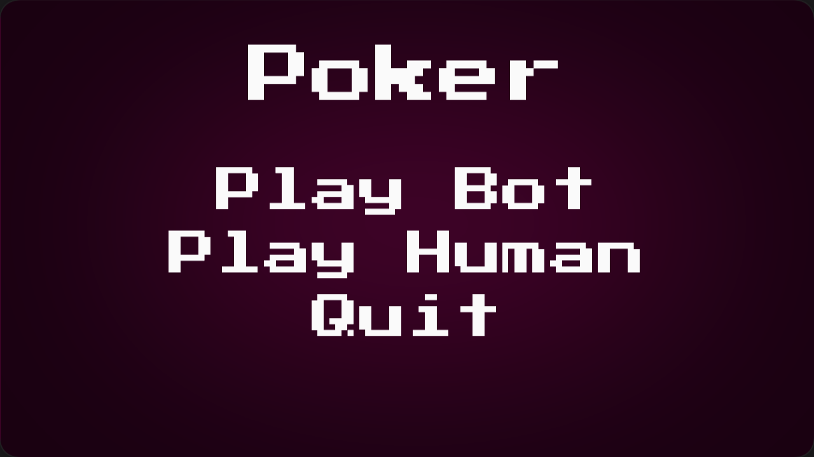
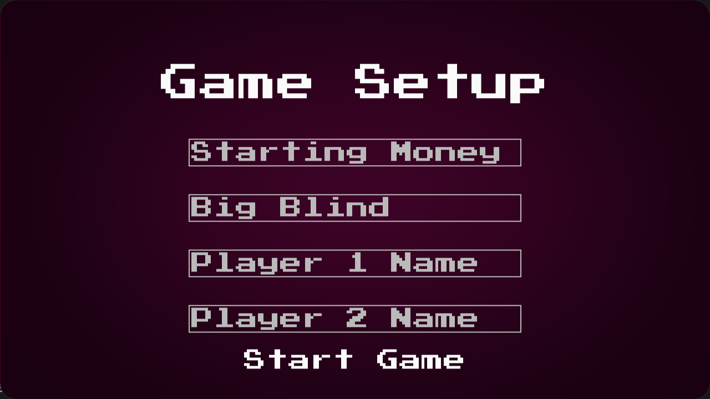
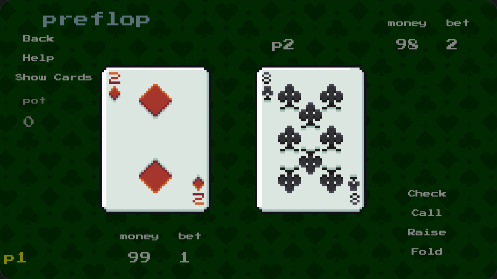
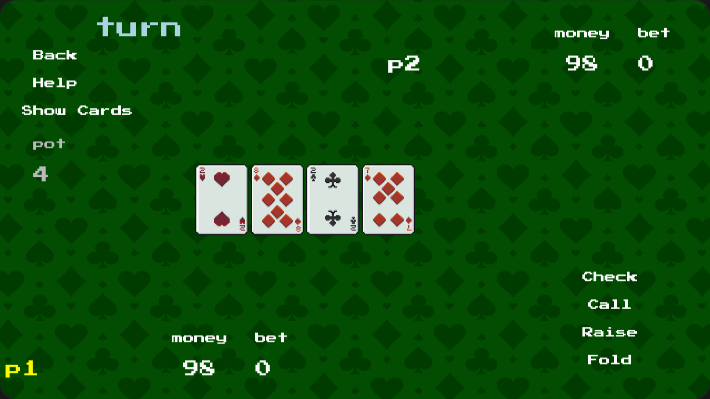
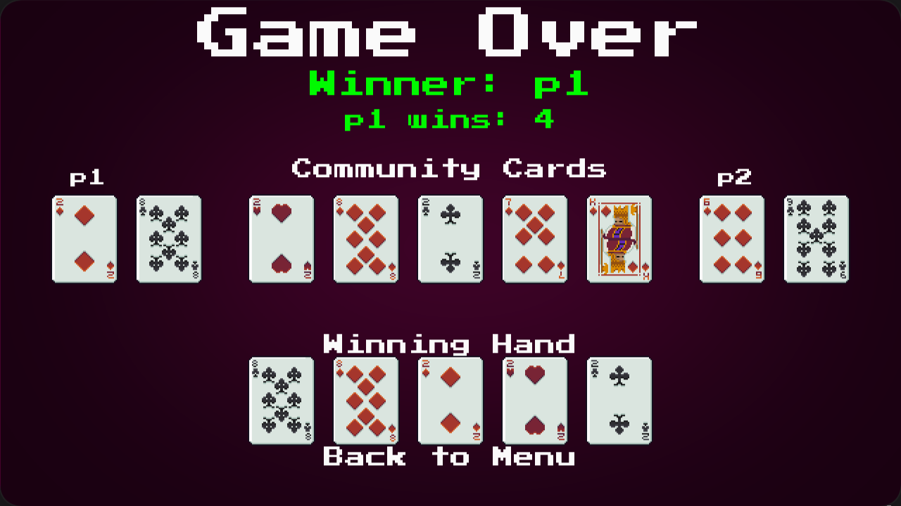

# Poker game
A poker game which lets you play 1v1 poker games against your friend or against an AI,

## What it does

Users can play against one another where they decide how much starting money they both have, and the amount of the big blind. Or users can play against an AI bot.

## How I built it

I used python for this project, with pygame as the UI and used tensorflow ad keras for the AI.

## How it works

I built the logic behind poker game first. This included the encoding each hand, making all the poker logic and evaluating two hands based on each player's hand and the community cards. 

Then I moved on to the bot. Because of the time constraints, I decided to make the bot fairly simple. It would be given its 2 cards, and depending on them and how many/what cards where in the community cards, the neural network would output a number between 0 and 1 which would represent how strong the hand was in the situation, 0 being the weakest and 1 the strongest. 

The AI was a neural network consisting of an input layer of the hand, then 3 hidden layers and then an output layer which gave the hand strength.

I then generated 100,000 hands for each of which I labeled which hand wins. Then I split them so I had 80,000 training hands and 20,000 test hands and trained the model over those 80,000 hands. After training I tested how well it did which was unfortunately not very good, but I did not have time to improve the AI.

## Challenges we ran into

Some major challenges that I ran into was adjusting to using new tools such as mypy and making logs as this is my first major project using python. The time constrains also meant that I was not able to do everything I wanted, and the AI was something that I still feel is lacking.

## What we learned

This project taught me how to lay out projects, the usefulness of mypy and log files as well as improved my use of git. It also introduced me to how to make a simple neural network.

## Built With

    python
    tensorflow

## Screenshots

 &nbsp; &nbsp; 

 &nbsp; &nbsp; 

:)
